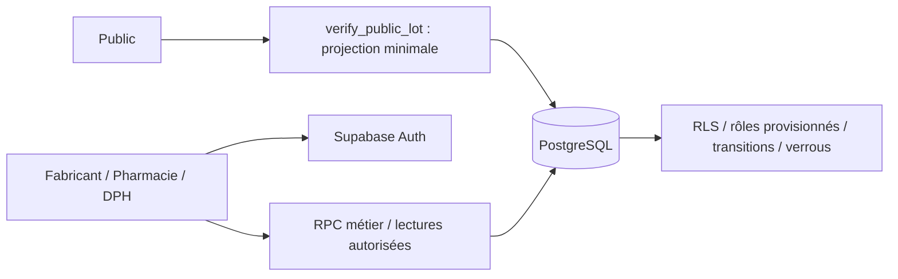

# Architecture actuelle

Expo SDK 54, React Native 0.81, React 19, Expo Router et NativeWind. Supabase est initialisé paresseusement. `businessRole.ts` consulte l’autorité DB ; les métadonnées modifiables du compte ne donnent aucun rôle. `workflowReads.ts` utilise les projections ciblées ; les workflows gardent leurs lectures métier autorisées.

`verification.ts` distingue FOUND, NOT_FOUND, INVALID_INPUT et UNAVAILABLE. Le journal est secondaire. Le public ne reçoit pas les contacts privés. Quelques identifiants internes historiques `authentique` restent dans les types/enums ; les libellés expliquent la correspondance au registre.

`businessWorkflows.ts` transmet une intention, jamais un acteur, verdict ou calcul de stock client. Les RPC imposent propriété, destinataire, transitions, demande associée, conservation, verrouillage et retry idempotent. Écritures brutes historiques fermées ou no-op selon B2. La base reste administrable : SHA-256 identifie, sans signature fabricant, preuve physique ou chaîne de blocs immuable.

La démo est un adaptateur local en mémoire, signalé par bandeau ; elle ne valide ni Auth/RLS, ni persistance, ni toutes les transactions. Les écritures métier sont désactivées. Vitrine statique indépendante. PDFs/designs MIABE historiques ; rapports `lot-*` et `phase-1-*` datés, sans exécution automatique.

## Shims

`metro.config.js` force le cœur QR et remplace plusieurs modules Node par `noop.js`. Le lock Supabase et ces remplacements héritent de contraintes web/native ; leur justification initiale exhaustive n’est pas retrouvée. Tests/export web passent, sans prouver l’équivalence native de chaque module. Retrait/upgrade à valider ensemble sur web et téléphone.

Sur web, Expo Camera charge déjà jsQR 1.2.0 (Apache-2.0) depuis cdn.jsdelivr.net. La démo ne contacte pas la DB mais ce script statique peut être téléchargé ; caméra entièrement hors ligne non promise. Les notices accompagnent l’export dans dist/legal.
