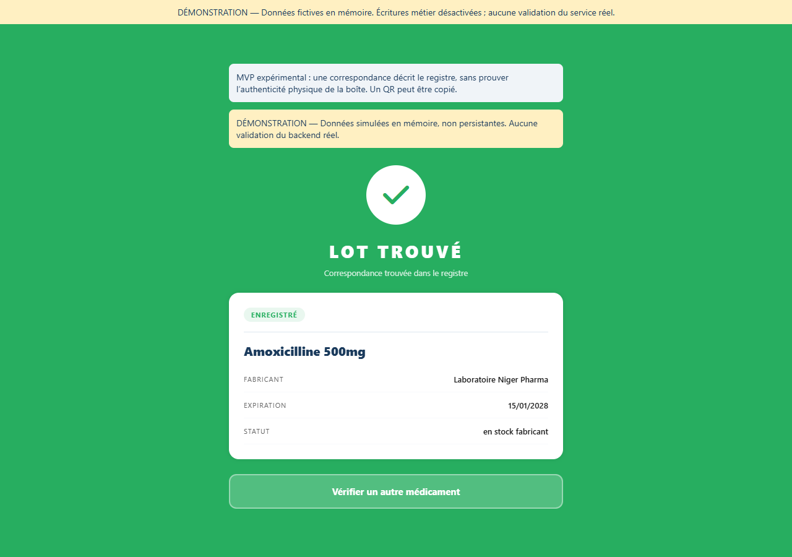
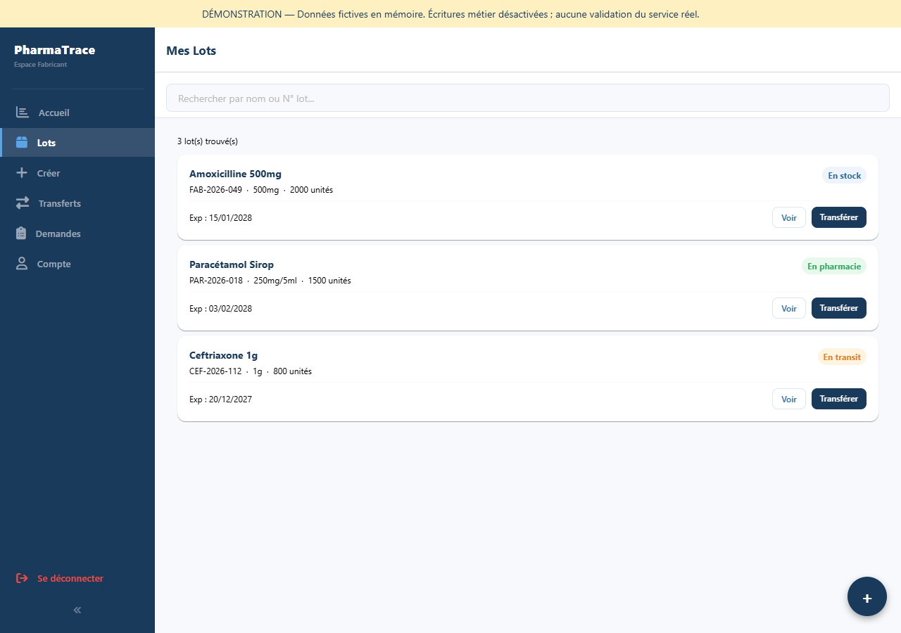
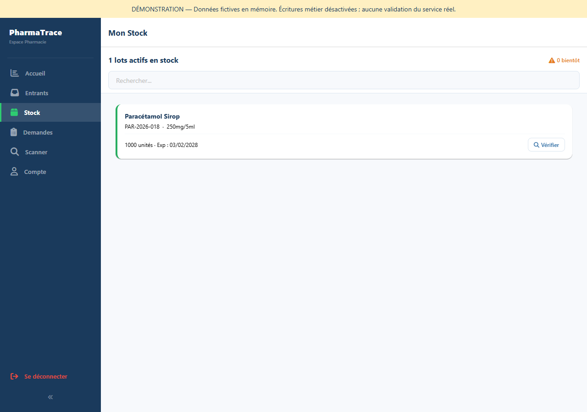

# Captures de l’interface locale

Captures réelles du client préparé dans ce sprint, navigateur local, données fictives en mémoire, mode Démo visible. Aucune session/profil réel, aucun export DB. Elles ne prouvent pas les parcours réels ni une validation physique Android ; les preuves métier réelles sont celles du gate phase 1.

Aperçu social original, sobre, sans badge de CI ou licence anticipé : [PNG](images/social-preview.png), [source SVG](images/social-preview.svg). Dimensions 1200 × 630. Upload GitHub préparé, pas effectué.
